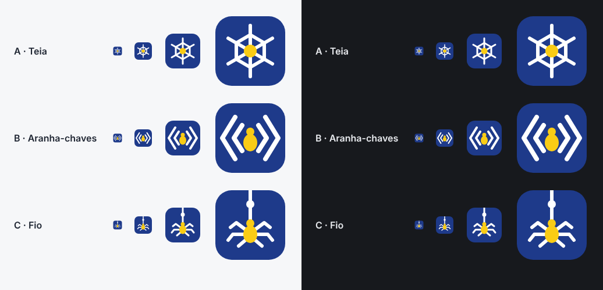

# Identidade visual

## Ícone


Uma aranha amarela pendurada num fio branco, sobre um quadrado azul-marinho de cantos arredondados.

- **A aranha** é a Anansi, a aranha dos contos akan que guarda todas as histórias. No app, as "histórias" são as collections de requests.
- **O fio** é o histórico versionado: cada request vira um arquivo num repositório git.
- **O nó no fio** representa um commit nesse histórico.

O ícone substituiu o anterior (`< • >` em branco e amarelo sobre azul). As cores continuam as mesmas.

## Paleta

| Uso                  | Cor        | Observação                                        |
| -------------------- | ---------- | ------------------------------------------------- |
| Fundo                | `#1e3a8a`  | Mesmo valor de `--accent` no tema claro           |
| Fio, nó e patas      | `#ffffff`  | Mesmo valor de `--accent-text`                    |
| Corpo da aranha      | `#facc15`  | Amarelo de destaque, usado só no ícone            |

## Arquivos

| Arquivo                                                        | Papel                                                                                   |
| -------------------------------------------------------------- | --------------------------------------------------------------------------------------- |
| `app-icon.svg`                                                 | **Fonte do ícone e favicon.** Toda mudança começa aqui                                  |
| `app-icon.png`                                                 | PNG 1024×1024 gerado a partir do SVG; é a entrada do `tauri icon`                       |
| `src-tauri/icons/` (`32x32.png`, `128x128.png`, `128x128@2x.png`, `icon.png`, `icon.ico`) | Ícones do executável, da janela e do instalador, listados em `tauri.conf.json` |
| `index.html`                                                   | Usa o próprio `app-icon.svg` como favicon (`<link rel="icon" href="/app-icon.svg">`); o Vite o copia para o `dist/` com hash no build |
| `docs/identidade-visual/alternativas/`                         | Propostas avaliadas e não escolhidas, e a prévia comparativa                            |

## Como atualizar o ícone

1. Edite o `app-icon.svg` (viewBox 64×64; mantenha o desenho dentro do quadrado arredondado).
2. Exporte o `app-icon.png` em 1024×1024 com fundo transparente fora do quadrado (qualquer editor vetorial, como Inkscape ou Figma, ou o navegador).
3. Gere os ícones do Tauri:

   ```powershell
   npm run tauri icon app-icon.png
   ```

4. O comando também cria ícones de Android, iOS e da Microsoft Store (`Square*Logo.png`, `StoreLogo.png`, `icon.icns`, `android/`, `ios/`). O app só usa os arquivos listados em `tauri.conf.json` e o `icon.png`; apague o restante antes do commit.
5. Confira o resultado em 16 px (aba do Explorer, barra de tarefas): o `icon.ico` inclui 16, 24, 32, 48, 64 e 256 px.

## Legibilidade em tamanhos pequenos

Em 16 px as patas e o nó do fio se fundem, e o ícone vira um ponto amarelo com um traço branco em cima. Ainda dá para reconhecer, mas se ficar ruim na barra de tarefas, a saída é criar uma variante simplificada só para 16 e 24 px (sem o nó e com 4 patas) e montar o `.ico` à mão.

## Alternativas avaliadas



| Proposta                        | Ideia                                                                         | Por que não foi escolhida                       |
| ------------------------------- | ----------------------------------------------------------------------------- | ----------------------------------------------- |
| A · Teia (`a-teia.svg`)         | Teia hexagonal com a aranha no centro: uma rede de requests                    | Os anéis da teia viram um borrão em 16 px       |
| B · Aranha-chaves (`b-aranha-chaves.svg`) | `<< • >>`: os sinais do ícone antigo, dobrados, viram as 8 patas      | Não comunica o versionamento em git, que a C mostra |
| C · Fio (`c-fio.svg`)           | Aranha pendurada num fio com um commit                                        | **Escolhida**                                   |
